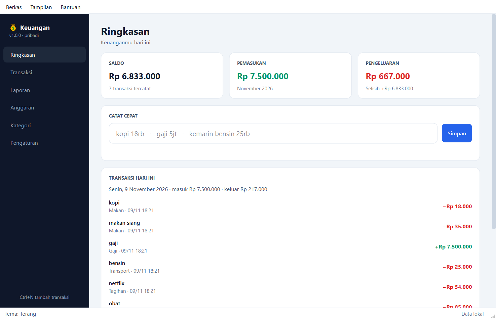

# Aplikasi Windows

Versi desktop dari proyek ini: aplikasi Qt/PySide6 yang jalan sebagai jendela
biasa, tidak lewat browser atau terminal.



## Menjalankan

Dari source:

```powershell
python -m venv .venv
.\.venv\Scripts\python.exe -m pip install -r requirements.txt
.\.venv\Scripts\python.exe -m desktop
```

Atau pakai installer: `dist\installer\Keuangan-Setup-1.0.0.exe` (34 MB).
Dipasang per-user tanpa UAC ke `%LOCALAPPDATA%\Programs\Keuangan`, ditambah
shortcut Start Menu dan Desktop.

## Halaman

| Halaman | Isi |
|---|---|
| Dashboard | Saldo, pemasukan/pengeluaran bulan ini, transaksi hari ini, peringatan anggaran, kotak catat cepat |
| Transaksi | Tabel transaksi; filter bulan dan jenis, cari catatan, ubah, hapus, undo |
| Laporan | Ringkasan bulanan, pengeluaran per kategori, tren 12 bulan, export CSV |
| Anggaran | Batas bulanan per kategori, progress bar, status |
| Kategori | Tambah, ubah, hapus kategori beserta kata kuncinya |
| Pengaturan | Nama, zona waktu, tema, lokasi data, backup, impor database |

Kotak catat cepat memakai parser yang sama dengan bot:

```
kopi 18rb
makan siang 35k
gaji 7.5jt
kemarin bensin 25.000
+500rb dari jual motor
kopi 18rb @Makan
```

Nominal yang diterima: `18rb`, `1,5jt`, `25.000`, `Rp25.000`, `kopi18rb`.
Tanggal: `kemarin`, `2 hari lalu`, `15/10`. Sebelum disimpan, aplikasi
menampilkan hasil tebakannya (jenis, kategori, nominal, tanggal).

## Lokasi data

```
%APPDATA%\Keuangan\finance.db        database SQLite
%APPDATA%\Keuangan\exports\          ledger-<id>.csv, diperbarui otomatis
%APPDATA%\Keuangan\backups\          backup harian, 7 terakhir
%APPDATA%\Keuangan\keuangan.log      log
```

Data tidak ditulis ke folder instalasi. Folder `Program Files` hanya bisa
dibaca, jadi database yang dibuat di sana akan gagal tanpa pesan.

Mode portable: taruh file kosong `portable.txt` di sebelah `Keuangan.exe`,
maka data pindah ke `data\` di folder yang sama. Untuk pengujian, set
environment `KEUANGAN_DATA_DIR`.

## Struktur kode

```
bot/            mesin pencatatan, dipakai bot dan aplikasi
  entry.py        parse -> jenis -> kategori -> simpan
  parser.py       teks bebas -> nominal, tanggal, jenis, kategori
  ledger.py       query, laporan, anggaran, export
  csvsync.py      penulisan CSV dan sanitasi formula
desktop/        lapisan tampilan
  service.py      semua operasi database, tanpa Qt
  paths.py        lokasi data
  theme.py        palet dan stylesheet terang/gelap
  pages/          satu file per halaman
  dialogs.py      dialog transaksi, kategori, anggaran
  models.py       model tabel transaksi
packaging/      spec PyInstaller, skrip Inno Setup, ikon, panduan
```

`bot/handlers/`, `bot/middlewares.py`, dan `bot/main.py` hanya dipakai bot
Telegram, tidak ikut ke installer desktop.

## Build installer

```powershell
.\.venv\Scripts\python.exe -m pip install -r requirements-build.txt
winget install JRSoftware.InnoSetup
powershell -ExecutionPolicy Bypass -File packaging\build.ps1
```

Urutannya: tes, ikon, PyInstaller, uji exe, Inno Setup. Build berhenti di
langkah pertama yang gagal.

```
dist\Keuangan\Keuangan.exe                  106 MB (folder, 788 file)
dist\installer\Keuangan-Setup-1.0.0.exe      34 MB
```

PyInstaller dipakai dengan `--onedir`. Dengan `--onefile`, 106 MB harus
diekstrak ke folder temp setiap kali aplikasi dibuka, dan hasilnya lebih
sering ditandai antivirus.

## Pemeriksaan

```powershell
.\.venv\Scripts\python.exe -m pytest              # semua tes
.\.venv\Scripts\python.exe scripts\desktop_smoke.py    # semua halaman tanpa jendela
.\.venv\Scripts\python.exe scripts\desktop_screens.py  # screenshot terang & gelap
.\.venv\Scripts\python.exe scripts\probe_exe.py        # exe hasil build
.\.venv\Scripts\python.exe scripts\probe_installer.py  # install, update, uninstall
```

## Masalah umum

**Aplikasi tidak terbuka.** Kemungkinan sudah berjalan; hanya satu instance
yang diizinkan. Cek taskbar, atau akhiri `Keuangan.exe` di Task Manager.

**Antivirus memblokir.** Exe tidak ditandatangani digital. Pilih *More info* →
*Run anyway*, atau kecualikan folder aplikasi.

**Data terasa hilang setelah update.** Data tidak pernah ada di folder
aplikasi. Cek `%APPDATA%\Keuangan`, atau `data\` kalau ada `portable.txt`.

**Pindah dari versi Telegram.** Pengaturan → *Impor database…* → pilih
`finance.db` milik bot. Database lama dibackup dulu. Penyalinan memakai API
backup SQLite, jadi transaksi yang masih ada di file `-wal` ikut terbawa.
